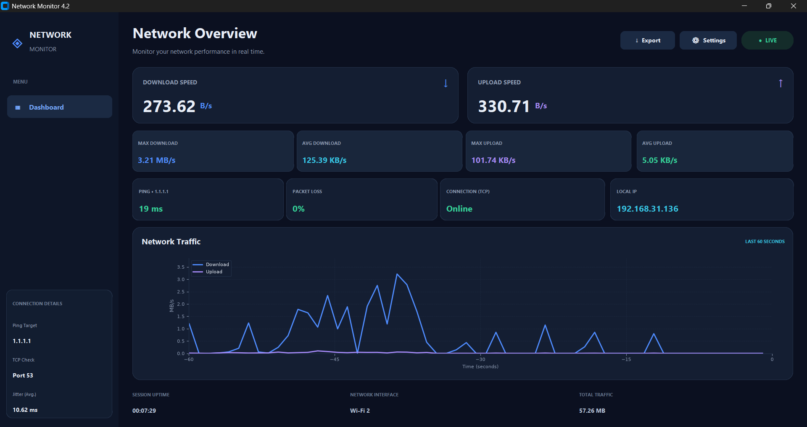
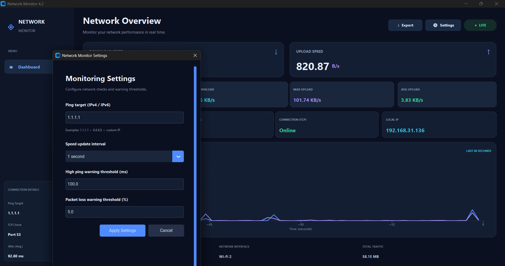
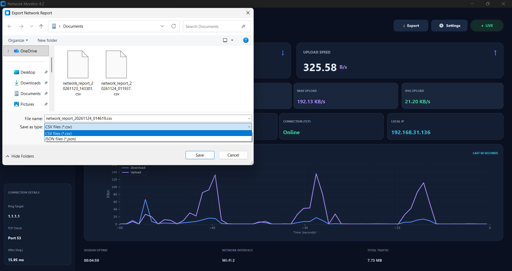
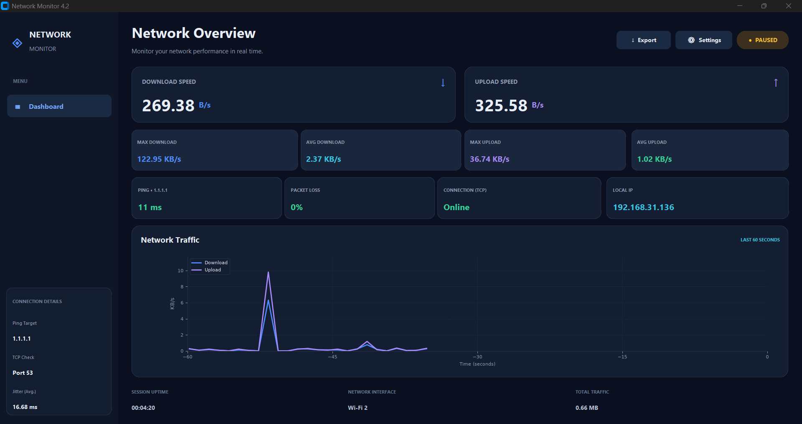

# Network Monitor

A real-time network monitoring desktop application built with Python. Monitor network traffic, connection quality, latency, and interface information through a modern graphical dashboard.

## Overview

Network Monitor is a desktop application designed to track network performance and visualize live network activity. It provides useful insights into download and upload speeds, latency, packet loss, and connection status.

## Features

- **Real-Time Traffic Monitoring** – Track download and upload speeds.
- **Live Traffic Visualization** – View network activity through dynamic graphs.
- **Ping Monitoring** – Measure network response time.
- **Packet Loss Detection** – Monitor packet transmission reliability.
- **Jitter Monitoring** – Observe variations in network latency.
- **Connection Status** – Detect network connectivity.
- **Network Interface Information** – Display the active interface and local IP address.
- **Traffic Statistics** – View average speed, maximum speed, and total traffic.
- **Data Export** – Export monitoring reports in CSV and JSON formats.
- **Pause and Resume** – Control monitoring sessions.
- **Custom Ping Target** – Configure the target IP address for latency measurements.

## Technologies Used

- Python
- CustomTkinter
- Matplotlib
- psutil

## Project Structure

```text
Network-Monitor/
├── main.py
├── dashboard.py
├── monitor.py
├── requirements.txt
├── README.md
├── LICENSE
└── Screenshots/
    ├── dashboard.png
    ├── settings.png
    ├── export.png
    └── live-paused.png
```

## Installation

1. Clone the repository:

```bash
git clone https://github.com/mrevan1002/Network-Monitor.git
```

2. Navigate to the project directory:

```bash
cd Network-Monitor
```

3. Install dependencies:

```bash
pip install -r requirements.txt
```

4. Run the application:

```bash
python main.py
```

## Screenshots

### Dashboard



### Settings



### Data Export



### Live / Paused Monitoring



## License

This project is licensed under the MIT License. See the [LICENSE](LICENSE) file for details.

## Author

Developed as a Python desktop application project.
